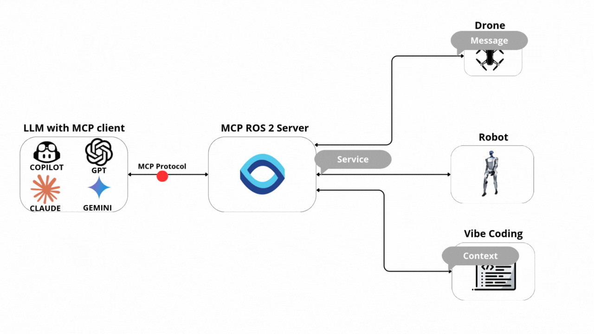

# ROS2 MCP

[](https://github.com/wise-vision/ros2_mcp/actions/workflows/server_tests.yml)
[](https://github.com/wise-vision/ros2_mcp/releases)
[](LICENSE)


[](https://hub.docker.com/r/wisevision/ros2_mcp)
[](https://discord.gg/9aSw6HbUaw)
[](https://wisevision.tech/docs/)

<!-- mcp-name: io.github.wise-vision/ros2_mcp -->



**ROS2 MCP** is an open-source (MPL-2.0) **Model Context Protocol** server that lets AI agents (Claude, Cursor, Codex and any other MCP client) list, subscribe to, publish on and call ROS 2 topics, services and actions on a live robot. It talks to ROS 2 directly through `rclpy`: no rosbridge, no changes to your robots. Transports: **stdio** (default), **Streamable HTTP** and SSE (deprecated by the MCP spec).

Every tool is free and open source. [Commercial support](#-commercial-support--integration) is available if you want help putting it on a real machine.

## ⚡ Quickstart (30 seconds, Docker)

You need Docker and an MCP client. ROS 2 itself does not have to be installed: the image contains it.

```bash
# Claude Code (use :humble for a ROS 2 Humble system). Read-only: the agent can look, not act.
claude mcp add ros2 -- docker run -i --rm -e ROS2_MCP_READONLY=1 wisevision/ros2_mcp:jazzy
```

Any other MCP client: run `docker run -i --rm -e ROS2_MCP_READONLY=1 wisevision/ros2_mcp:jazzy` as its stdio command. Then ask: *"List the ROS 2 topics"* and *"Read three messages from /chatter"*.

No robot at hand? Start a demo publisher first:

```bash
docker run -d --name demo-robot ros:jazzy-ros-base bash -c \
  'source /opt/ros/jazzy/setup.bash && ros2 topic pub -r 2 /chatter std_msgs/msg/String "{data: hello from the robot}"'
```

Prefer `uv`? On a machine with ROS 2 installed and sourced (the server needs `rclpy`; use the Python that matches your distro, e.g. 3.12 on Jazzy):

```bash
source /opt/ros/jazzy/setup.bash
uvx --python /usr/bin/python3 --from git+https://github.com/wise-vision/ros2_mcp mcp_ros_2_server
```

Remove `-e ROS2_MCP_READONLY=1` (or the `--read-only` flag) only when you want the agent to be able to move things; see [Security](#-security-read-only-mode). Client-specific setup (VS Code Copilot, Claude Desktop, Warp, Codex CLI, custom messages): [installation guide](installation/README.md). Docs: [wisevision.tech/docs](https://wisevision.tech/docs/).

> `mcp/ros2` in Docker's official MCP catalog (13,750 pulls at the time of writing) is built by Docker and lags our releases: it was last updated on 2026-02-04 and predates read-only mode. `wisevision/ros2_mcp` is built and pushed by this repository's CI and is the one the commands above use.

## 🧰 Tools

24 tools. ⚠ marks tools that can change robot state; [read-only mode](#-security-read-only-mode) removes them. The complete, generated reference with input schemas is [`docs/generated/tools.md`](docs/generated/tools.md) (a CI check keeps it in sync with the code).

| Area | Tools |
|---|---|
| **Discover** | `ros2_topic_list`, `ros2_service_list`, `ros2_list_actions`, `ros2_interface_list`, `ros2_get_message_fields` (field names and types of a message type) |
| **Topics** | `ros2_topic_subscribe`, `ros2_subscribe_multiple_topics` (images come back as PNG), ⚠ `ros2_topic_publish`, ⚠ `ros2_publish_multiple_topics` (set frequency and duration) |
| **Services** | ⚠ `ros2_service_call` |
| **Actions** | ⚠ `ros2_send_action_goal` (optionally waits for the result), `ros2_action_request_result`, `ros2_action_subscribe_feedback`, `ros2_action_subscribe_status`, ⚠ `ros2_cancel_action_goal` |
| **Perception** | `ros2_get_map_as_image` (`nav_msgs/OccupancyGrid` to PNG), `ros2_get_pointcloud_as_bev` (`sensor_msgs/PointCloud2` to bird's-eye-view PNG) |
| **History** | `ros2_get_messages_stored_in_influx_data_base` (past messages from the [WiseVision Data Black Box](https://github.com/wise-vision/wisevision_data_black_box), an [InfluxDB](https://www.influxdata.com)-based alternative to [Rosbag2](https://github.com/ros2/rosbag2)) |
| **Viewer app** | `ros2_viewer_app`, `ros2_viewer_config`, `ros2_stream_start`, `ros2_stream_next`, `ros2_stream_next_image`, `ros2_stream_stop` (interactive image / point cloud / plot viewer for MCP clients that support Apps; the stream tools also serve clients that cannot render it) |

Also included: four built-in [prompts](#-prompts), automatic QoS selection for topics, nested message fields, and custom message types (source your package before starting; see the [installation guide](installation/README.md#add-custom-messages)).

## 🧭 Supported ROS 2 distributions

| Distro | Ubuntu · Python | ROS EOL | Status | Tested in CI | Image tags (`wisevision/ros2_mcp`, amd64 + arm64) |
|---|---|---|---|---|---|
| **Lyrical Luth** | 26.04 · 3.14 | May 2031 | ✅ Supported (LTS) | Unit tests + end-to-end smoke | `:lyrical` · `:lyrical-<release>` · `:latest` |
| **Jazzy Jalisco** | 24.04 · 3.12 | May 2029 | ✅ Supported (LTS) · default | Unit tests + end-to-end smoke | `:jazzy` · `:jazzy-<release>` |
| **Humble Hawksbill** | 22.04 · 3.10 | May 2027 | ✅ Supported (LTS) | Unit tests + end-to-end smoke | `:humble` · `:humble-<release>` |
| **Rolling Ridley** | 26.04 · 3.14 | rolling | 🧪 Experimental: tested, never blocks a release | Unit tests + end-to-end smoke (allowed to fail) | `:rolling` |
| Kilted Kaiju | 24.04 · 3.12 | Dec 2026 | ❌ Not shipped (short-term release) | — | — |

Every LTS distribution is supported for its whole ROS lifetime. Short-term releases are skipped: use the LTS before or after them. Rolling tracks the next LTS, so problems show up months before it ships. It can break in place, so its image is best-effort.

**Tested in CI** means:
- **Unit tests** run on every pull request and nightly, inside the official `ros:<distro>-ros-base` image.
- **End-to-end smoke** runs on every pull request and before every image is published, including the weekly rebuild. It builds the Docker image and starts a real publisher in a second container. The server then runs over stdio in read-only mode and must find the topic, receive its messages and register no state-changing tool. This runs once for each RMW in the image: `rmw_fastrtps_cpp` (default), `rmw_cyclonedds_cpp` and `rmw_zenoh_cpp` (with a router). Run it yourself with `scripts/smoke_e2e.sh <image>`.

The server must use the same distribution as your robot: ROS 2 does not support nodes talking across distributions. Message packages for common stacks (Nav2, MAVROS, MoveIt, ros2_control, vision_msgs) are in every image where the distro releases them. On Rolling, `nav2_msgs` is not released yet; the image lists what it skipped in `/etc/ros2_mcp/skipped-packages`.

ROS 1 is not supported (the server uses `rclpy`). Python 3.10 or newer.

Lyrical and Rolling images are published from the first release after 2610.

### 🏷️ Docker image tags

Pick a tag by what you want to happen when we ship something new:

| Tag | What it is | When it changes | Use it for |
|---|---|---|---|
| `:jazzy` (any distro) | The latest release for that distro | At each release, and weekly with security updates of the base image | **Most people.** Pin your robot's distro and get tested updates automatically |
| `:jazzy-2610`, `:jazzy-2610.1` | That release, exactly | Never. We refuse to overwrite it | Reproducible setups: MCP catalogs, CI, fleets you roll out on your own schedule |
| `:jazzy-main` | Merged but not yet released | Every merge to `main` | Trying a fix before it is released |
| `:latest` | The newest LTS (`:lyrical`) | With `:lyrical` | Quick tries when you don't care about the distro. A robot needs its own distro |
| `:rolling` | The latest release on Rolling | At each release and weekly. Best-effort | Rolling users. There is no frozen Rolling tag, because Rolling itself changes in place |

Every tag is multi-arch (amd64 + arm64). `-amd64` / `-arm64` variants exist for each, and are immutable too for release tags. Releases are cut whenever something user-visible lands, so `:<distro>` never lags far behind `main`. They are named `YYMM`; a second release in the same month is `YYMM.1`, `YYMM.2`, ... Nothing is published untested: amd64 and arm64 images are both built natively and both pass the end-to-end smoke test (a live ROS 2 graph on every shipped RMW). The pushed image is the exact image that was tested. For a bit-for-bit pin, use the digest: `wisevision/ros2_mcp@sha256:…`.

## 🆚 How it compares

Other open-source ROS MCP servers exist. They make different trade-offs; pick by what you need. Facts below were read from each project's README, `pyproject.toml` and GitHub page on 2026-10-14.

| | **ROS2 MCP** (this repo) | [robotmcp/ros-mcp-server](https://github.com/robotmcp/ros-mcp-server) | [LCAS/ros2_mcp](https://github.com/LCAS/ros2_mcp) |
|---|---|---|---|
| How it reaches ROS | `rclpy`, directly on the ROS 2 graph (runs where ROS 2 is sourced, or in the Docker image) | `rosbridge` WebSocket; the MCP server can run on a different machine from the robot | ROS 2 package built in your colcon workspace |
| ROS versions | ROS 2 Humble, Jazzy | ROS 1 and ROS 2 | ROS 2 Humble, Iron, Jazzy (per its README) |
| Install | Docker image `wisevision/ros2_mcp`, or `uvx`/`uv` from git | `uvx ros-mcp` (on PyPI) | `git clone`, `rosdep`, `colcon build`; Docker Compose with an SSE endpoint |
| Transports | stdio, Streamable HTTP, SSE | stdio, `http`, `streamable-http` (`--transport`) | SSE endpoint documented |
| Read-only mode | Yes: mutating tools are not registered, and a test enforces the classification | No such switch found in its code; tools carry the MCP `readOnlyHint` annotation | Its README lists observation features only |
| Publish / services / actions | Yes, including goal, result, feedback, status and cancel | Yes (topics, services and actions tools) | Not listed in its README |
| Nodes and parameters | **No** dedicated tools yet | Yes (node and parameter tools) | Node listing |
| Images and maps | Image topics as PNG, occupancy-grid map, point-cloud bird's-eye view | Image tool | Image retrieval for VLM analysis |
| License | MPL-2.0 | Apache-2.0 | Apache-2.0 |
| GitHub stars | 90 | 1,493 | 9 |

When to pick another one: you need **ROS 1**, node or parameter tools, or you want the MCP server **off the robot** with only rosbridge exposed there: use `robotmcp/ros-mcp-server`. We do not claim to be better on every axis. What we offer: native `rclpy` access (no bridge process between the agent and DDS), a read-only mode that fails closed (a tool is registered in that mode only if it was explicitly reviewed as read-only, and a test fails when a new tool is unclassified), images, maps and point clouds returned as PNGs, the complete action lifecycle (goal, result, feedback, status, cancel), and commercial support if you need it. Something here is wrong or out of date? [Open an issue](https://github.com/wise-vision/ros2_mcp/issues) and we will fix it.

## 🗺️ Roadmap (proposed, not committed)

What users ask for that is **not** in ROS2 MCP today. No dates; open an issue or a Discussion to vote or to pay for one.

- **Parameter tools**: get / set / list node parameters.
- **TF tools**: transform lookup and frame tree.
- **Authentication for Streamable HTTP** (bearer token or a documented reverse-proxy recipe). The transport itself is in [#55](https://github.com/wise-vision/ros2_mcp/pull/55); until auth exists, keep it on loopback or a private network.
- **Node tools** (list nodes, node info), Nav2-specific helpers, a PyPI package, ROS 1 (not planned).

## 🤖 For AI agents

If you are an agent (or building one) using this server:

- **Match the robot's distro.** Use `wisevision/ros2_mcp:<distro>` with the robot's ROS 2 distribution (`ros2 doctor --report` or `echo $ROS_DISTRO` on the robot shows it); ROS 2 nodes can't talk across distributions. Pin `:<distro>-<release>` if you write a config someone else will run later.
- **Discover before you act.** Call `ros2_topic_list`, `ros2_service_list`, `ros2_list_actions` and `ros2_interface_list`, then `ros2_get_message_fields` for the exact message type, before any publish, service call or action goal. Do not guess field names.
- **Prefer read-only.** If `ros2_topic_publish`, `ros2_service_call`, `ros2_send_action_goal` are absent from `list_tools`, the operator started the server in read-only mode; do not try to work around it.
- **Mutating tools move real machines.** Confirm intent with the human before calling a ⚠ tool, start with small values and a short duration, and keep `ros2_cancel_action_goal` in mind.
- **Right after container start the graph may be incomplete** (DDS discovery). If a topic you expect is missing, retry once before concluding it does not exist; see [DDS discovery warm-up](#-dds-discovery-warm-up-docker).
- **Machine-readable references:** [`docs/generated/tools.json`](docs/generated/tools.json) (every tool and its input schema), [`server.json`](server.json) (MCP registry manifest), [`AGENTS.md`](AGENTS.md) (repo layout, how to build, test and add a tool), [wisevision.tech/llms.txt](https://wisevision.tech/llms.txt).

## 🏢 Commercial support & integration

ROS2 MCP is free software under the **MPL-2.0**: you can use it in a commercial product without asking us. Nothing in this section changes that.

If you are putting it on a real robot or fleet and want more than the public issue tracker, WiseVision (the maintainers) can help with:

- **Integration support**: getting the server running against your stack, your message types and your QoS constraints.
- **Custom tools and prompts**: handlers for your own interfaces, beyond the built-in topic, service and action set.
- **Priority fixes**: a defect that blocks your deployment, handled on a schedule instead of a backlog.

**How to reach us:** use the form at [wisevision.tech/contact](https://wisevision.tech/contact/) (choose *ROS2 MCP on a real fleet*) or write to **hello@wisevision.tech**. Tell us the problem first: what robot, what stack, what is blocking you. We scope and quote per project; there is no price list, so please contact us. Questions that other users could learn from belong in [Discussions](https://github.com/wise-vision/ros2_mcp/discussions/categories/q-a) or [issues](https://github.com/wise-vision/ros2_mcp/issues).

Want to see it on real data first? The [forklift rosbag demo](examples/forklift_rosbag_demo/README.md) replays a warehouse forklift recording and walks through three MCP calls in about ten minutes.

## ⚙️ Installation

Follow the [installation guide](installation/README.md) for step-by-step instructions:
- [🧩 Install in Visual Studio Code Copilot](installation/README.md#configure-visual-studio-code-copilot)
- [🤖 Install in Claude Desktop](installation/README.md#configure-claude-desktop)
- [💻 Install in Warp](installation/README.md#configure-warp)
- [🐳 Build Docker Image locally](installation/README.md#build-docker-image-locally)

## 🔒 Security: read-only mode

An agent connected to a real robot can move it. Start the server in **read-only mode** to let the agent observe but not act:

```bash
ROS2_MCP_READONLY=1 uv run mcp_ros_2_server      # env var
uv run mcp_ros_2_server --read-only              # or CLI flag
docker run -i --rm -e ROS2_MCP_READONLY=1 mcp/ros2
```

In read-only mode the tools that change robot state are **not registered at all**: they do not appear in `list_tools`, and calling one returns an `Unknown tool` error. The hidden tools are:
`ros2_topic_publish`, `ros2_publish_multiple_topics`, `ros2_service_call`, `ros2_send_action_goal`, `ros2_cancel_action_goal`.
Read-only mode fails closed: only tools that were explicitly reviewed as read-only (listed in [`server/tool_safety.py`](server/tool_safety.py)) are registered, and a test fails if a new tool is added without being classified.
`ros2_service_call` is hidden because the server cannot know whether an arbitrary service has side effects.

## 🌐 Streamable HTTP (remote / multi-client)

stdio is the default and needs no network. To serve several clients, or a client on another machine, use **Streamable HTTP**, the transport the current MCP specification defines (the older `sse` transport is deprecated by the spec and kept only for existing clients).

```bash
uv run mcp_ros_2_server --transport streamable-http          # http://127.0.0.1:8123/mcp
claude mcp add --transport http ros2 http://127.0.0.1:8123/mcp   # Claude Code; other clients: use the URL
```

Docker (publish the port on loopback only):

```bash
docker run --rm -p 127.0.0.1:8123:8123 \
  -e ROS2_MCP_TRANSPORT=streamable-http -e ROS2_MCP_HOST=0.0.0.0 -e ROS2_MCP_READONLY=1 \
  wisevision/ros2_mcp:jazzy                                 # http://127.0.0.1:8123/mcp
```

`ROS2_MCP_HOST=0.0.0.0` is needed inside the container (a loopback bind is unreachable through `-p`); the `127.0.0.1:` in `-p` keeps it off your network. If the first tool call lists no topics, DDS discovery is not crossing the container boundary; on Linux `--network host` (then drop `-p` and `ROS2_MCP_HOST`) is the usual fix, but that depends on your DDS and network setup.

| Option | Env var | Default | |
|---|---|---|---|
| `--transport` | `ROS2_MCP_TRANSPORT` | `stdio` | `stdio`, `streamable-http`, `sse` |
| `--host` | `ROS2_MCP_HOST` | `127.0.0.1` | `0.0.0.0` inside a container |
| `--port` | `ROS2_MCP_PORT` | `8123` | |
| `--allowed-host HOST[:PORT]` | `ROS2_MCP_ALLOWED_HOSTS` | localhost only on a loopback bind | accepted `Host` headers (DNS-rebinding protection); repeatable / comma-separated; `*` matches any port |
| `--stateless`, `--json-response` | | off | no per-client session state; plain JSON instead of an event stream |

> ⚠️ **There is no authentication.** Anyone who can reach the port can use every tool, including publishing to topics. Keep it on loopback or a private network, put an authenticating reverse proxy in front of anything wider, and consider [read-only mode](#-security-read-only-mode). The server prints a warning when it binds to a non-loopback address.

## 🧭 DDS discovery warm-up (Docker)

If the first tool call returns an incomplete list of topics/services right after container start, DDS discovery may still be in progress.
The server performs a one-time warm-up on the first tool call in container environments; tune it via:

- `MCP_ROS_DISCOVERY_STABLE_SEC` (default: `1.0`)
- `MCP_ROS_DISCOVERY_TIMEOUT_SEC` (default: `5.0`)
- `MCP_ROS_DISCOVERY_WARMUP=false` to disable

## 🤖 Prompts
### 📘 Want to create a custom prompt? [Check the guide here](docs/CREATE_PROMPT.md)

### 📊 base.ros2-topic-echo-and-analyze

Subscribe to a ROS2 topic, collect messages for a specified duration, and provide statistical analysis of the collected data.

➡️ Can auto-detect topic if only one is available. Analyzes message rates, counts, and statistics on numeric fields.

### 🔄 base.ros2-topic-relay

Subscribe to one ROS2 topic and republish messages to another topic with optional transformations.

➡️ Supports identity relay, rate limiting, and change-based filtering.

### 🏥 base.ros2-node-health-check

Check if expected ROS2 topics and services are available and functioning correctly with optional publication rate monitoring.

➡️ Provides comprehensive health report with status indicators and recommendations.

### 🔍 base.ros2-topic-diff-monitor

Compare two ROS2 topics and report differences in their messages with detailed field-by-field analysis.

➡️ Useful for comparing raw sensor data with filtered/processed versions or verifying topic synchronization.

ROS2 MCP also has a prompts extension with additional prompts: [see here](https://github.com/wise-vision/ros2_mcp_prompts)


### 💡 Don’t know what prompts are? [See the MCP spec here](https://modelcontextprotocol.io/specification/2025-06-18/server/prompts#user-interaction-model).

**Note:** To call a service with a custom (non-default) type, source the package that defines it before starting the server.

## 🎬 Demos

### 🚀 Drone mission using prompts


### 🌍 Real-world example


Want to try it in simulation? See the [Gazebo drone demo](docs/DEMO_DRONE.md).

## 🐞 Debugging

Since MCP servers run over stdio, debugging can be challenging. For the best debugging
experience, we strongly recommend using the [MCP Inspector](https://github.com/modelcontextprotocol/inspector).

You can launch the MCP Inspector via [ `npm` ](https://docs.npmjs.com/downloading-and-installing-node-js-and-npm) with this command:

```bash
npx @modelcontextprotocol/inspector uv --directory /path/to/ros2_mcp run mcp_ros_2_server
```

Upon launching, the Inspector will display a URL that you can access in your browser to begin debugging.

## 🤝 Contributing

Contributions are welcome. Check the [open issues](https://github.com/wise-vision/ros2_mcp/issues), open a pull request, or drop by our [Discord](https://discord.gg/9aSw6HbUaw) to discuss ideas first. See [`AGENTS.md`](AGENTS.md) for dev setup and tests. By participating you agree to our [Code of Conduct](CODE_OF_CONDUCT.md).

## 📚 Origins

We built this server to make AI‑assisted ROS 2 development fast and reliable. Internally, we needed a simple way for agents to discover message types, publish/subscribe to topics, and call services—without boilerplate or flaky networking. That led to a few core design goals:
- Handle all ROS 2 message types (including nested fields) so agents can write and test any code
- Integrate topic pub/sub and service calls to validate behavior end‑to‑end
- Work seamlessly with GitHub Copilot in VS Code and other MCP clients
- Use a simple stdio transport to avoid network complexity

After dogfooding it, we open‑sourced the project (MPL-2.0) to help the broader ROS 2 community build faster with AI. It’s now useful not only for development, but also for controlling robots, running QoS experiments, and analyzing live data and robot/swarm state. The project is actively maintained—features and improvements ship regularly based on user feedback. If this project helps you, share your use case in [Discussions](https://github.com/wise-vision/ros2_mcp/discussions)!
